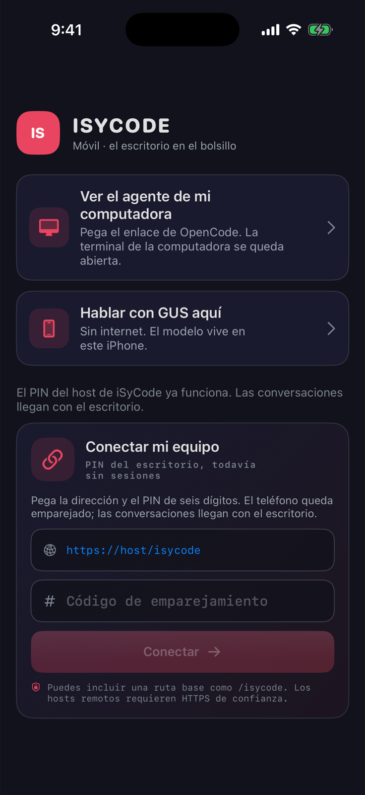
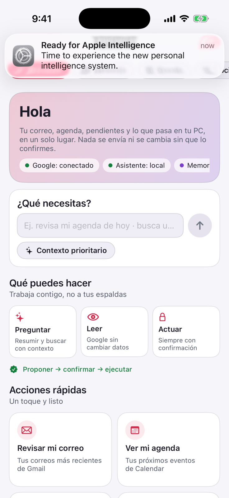
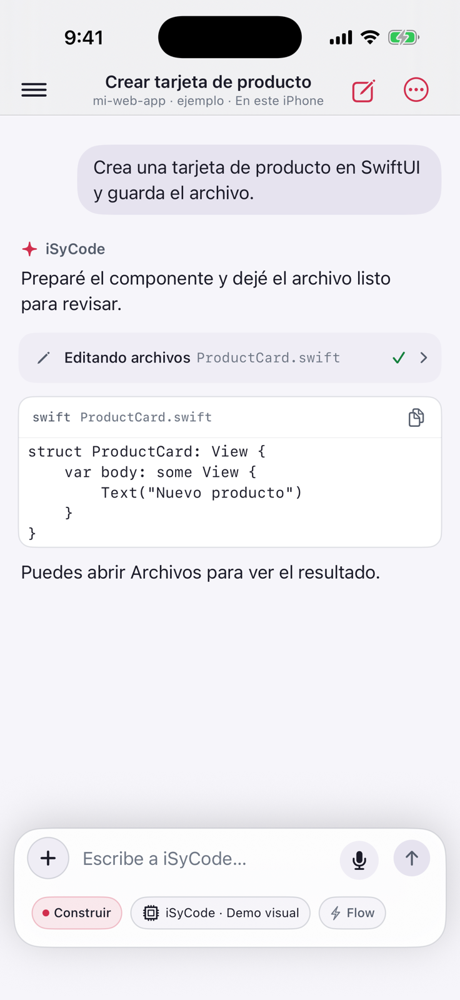
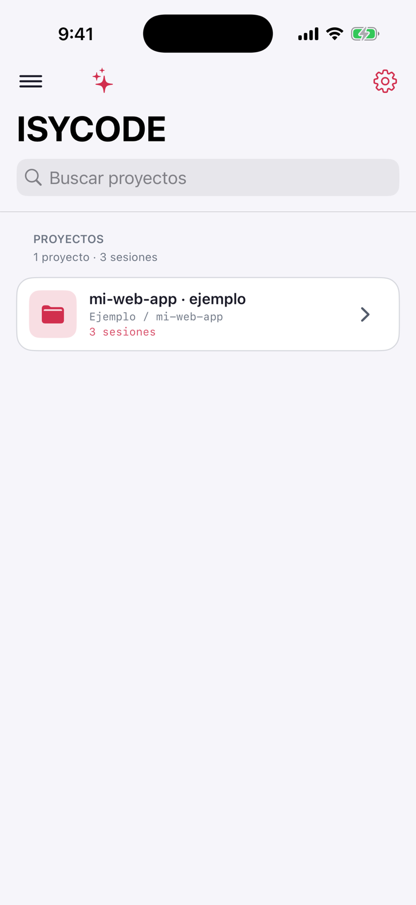
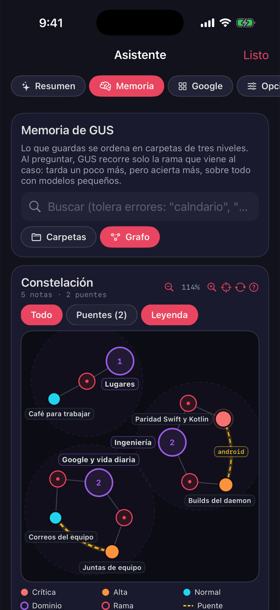

# iSyCode Móvil

[](https://github.com/DannyBaanks/iSyCodeMovil/actions/workflows/ios-build.yml)
[](https://github.com/DannyBaanks/iSyCodeMovil/actions/workflows/android.yml)
[](https://github.com/DannyBaanks/iSyCodeMovil/actions/workflows/gus-catalog.yml)

Cliente móvil nativo para iOS (SwiftUI + `llama.cpp` + `pocketpy` v2.2.0 + WDA / ISyMCP) para conversar con agentes de IA, ejecutar modelos locales o en la nube, crear tus propios agentes con contratos `.isyagent.json`, automatizar tareas en el iPhone o conectarte de forma segura a tu computadora.

> **Importante:** iSyCode Móvil **no** ejecuta el binario de escritorio de OpenCode en iOS (iOS prohíbe `fork`/`exec`, PTYs e intérpretes arbitrarios del sistema). Todo lo que corre en el dispositivo está implementado de forma nativa en Swift/C dentro de los límites de iOS (`docs/OPENCODE_COMPAT.md`, `docs/IOS_LIMITATIONS.md`).

---

## Capturas (generadas en Simulador iOS por CI)

| Conexión | Inicio / Asistente | Chat | Proyectos | Grafo de memoria |
|---|---|---|---|---|
|  |  |  |  |  |

---

## Qué hace iSyCode Móvil hoy

### 1. Experiencia de chat y navegación (`AppShellView`, `ChatSidebarView`)
- **Shell conversacional adaptativo**: inicio limpio con sugerencias (`ChatLandingView`), menú lateral deslizable en iPhone y `NavigationSplitView` en pantallas amplias (*Conversaciones*, *Inicio*, *Construir*, *Mis agentes*, *Navegador*, *Proyectos*, *Google y memoria*, *Conexiones*, *Ajustes*).
- **Timeline rico y estado visible**: renderizado de bloques Markdown (`ChatMarkdownBlocks`), tarjetas de herramientas con errores expandibles, shimmer de razonamiento (`ThinkingShimmerView`) y generación automática de títulos (`ConversationTitleService`).
- **Control en vivo por turno**:
  - **Selector de Razonamiento** (`Auto`, `Bajo`, `Medio`, `Alto`) desde la pill del modelo.
  - **Modo Flow**: aprueba automáticamente herramientas no excluidas durante el turno activo.
  - **Aprobación acotada por secuencia WDA** (`Permitir secuencia WDA por esta tarea`): cubre únicamente acciones `iphone_*` dentro de ese turno.
  - **Navegador integrado (`InAppBrowserView`)** con modo manual (*tomar control*).

### 2. Modelos locales (GUS) y proveedores en la nube (`SandboxModelProviders`)
- **GUS local en este iPhone (`GUSLocalModelProvider`, `llama.cpp`)**: inferencia GGUF totalmente offline en el dispositivo, con catálogo fijado por SHA-256 (`Catalog/models.json`, 22 modelos verificados en Swift + Kotlin) y descargas en segundo plano (`GUSModelDownloadManager`). Los pesos `.gguf` nunca se empaquetan dentro del IPA.
- **Proveedores en la nube desde el iPhone**:
  - **NVIDIA NIM** (lista curada, incluyendo visión con `nvidia/nemotron-3.5-super-vl-120b-a12b`).
  - **xAI · Grok**, **OpenAI API**, **Google Gemini**, **OpenRouter**.
  - **ChatGPT Plus/Pro (OAuth)** (`ChatGPTOAuthService` / `ChatGPTCodexProvider`): flujo OAuth de dispositivo con notificación local, copiado automático de código y descubrimiento dinámico de modelos Codex.
- **Backends conectados a tu computadora**: `CodexRemoteBackend`, `GrokRemoteBackend`, `OpenCodeRemoteBackend` y `ISyCodeBridge` (`Bridge/`).

### 3. Constructor de agentes, contratos `.isyagent.json`, Python embebido y tools L0/L1
- **Constructor guiado en 6 pasos (`AgentBuilderView`)**: Meta (`Paso A`) → Capacidades (`Paso B`) → Personalización (`Paso C`) → Autorizaciones (`Paso D`) → Prueba en vivo (`Paso E`) → Guardar / Exportar contrato (`Paso F`), acompañado del asesor contextual **GUS** (`GUSContextualAssistantView`).
- **Contratos `.isyagent.json` (`AgentContract`, `schemaVersion = "1.0"`)**: definición portable del agente (objetivo, instrucciones, primitivas L0, herramientas compuestas L1, scripts, alcances de permiso, alias de secretos requeridos y pruebas). Al exportar se elimina `localApprovalGrantedAt` y jamás se exportan secretos.
- **Runtime Python 3 embebido (`pocketpy` v2.2.0 + `GUSPythonBridge.c`)**: máquina virtual ligera sin acceso al SO (`PK_ENABLE_OS = 0`), watchdog de instrucciones con timeout (`PK_ENABLE_WATCHDOG = 1`) y módulo `stdc` de punteros deshabilitado, expuesta mediante la herramienta `python_eval` (`PythonRuntimeService`).
- **Arquitectura L0 / L1 (`DynamicToolRegistry`)**:
  - **L0**: primitivas atómicas del sandbox (archivos), `python_eval`, `http_request`, navegador, Google Workspace, notificaciones, Shortcuts, control `iphone_*` e `isymcp_*`.
  - **L1**: herramientas compuestas creadas con `l1_create_tool` (`l1_list_tools`, `l1_delete_tool`) o mediante demostración; heredan estrictamente la unión de permisos, restricciones, flags `isDestructive` y `requiresApprovalEveryTime` de sus pasos L0.

### 4. Aprender acción por demostración y Sistema de Llavero
- **Aprender acción (`ActionRecorderService` + `LearnActionRecorderSheet`)**:
  - Prepara objetivo y parámetros esperados (`learn_action_prepare` / `learn_action_status`).
  - Mantiene polling contra WDA (`127.0.0.1:8100`) mientras sales de iSyCode a ejecutar la tarea en apps reales (p. ej. WhatsApp o Safari), compara cambios de app y árbol de accesibilidad (`ActionRecorderDiffEngine`), te permite parametrizar campos (p. ej. `{{destinatario}}`) y compila el flujo como una herramienta `l1_*`.
- **Sistema de Llavero (`SecretVaultStore` + `KeychainHelper` + `SecretVaultSheet`)**:
  - Guarda usuario, contraseña o token **únicamente** en Apple Keychain con protección biométrica (`LAContext` / Face ID). En disco solo vive un índice no sensible (`secret_vault_index.json`).
  - Los agentes y flujos compilados solo referencian tokens opacos `{{secret:alias.campo}}` (sin exponer el secreto en prompts, historial ni `.isyagent.json`) y aplican redacción automática (`SecretVaultStore.redact`).
  - Ningún modo automático (*Flow*, *Permitir siempre* o *Permitir secuencia WDA*) puede saltarse la confirmación manual en pasos que referencien `{{secret:...}}`.

### 5. Adjuntos nativos (`+`), Cámara, Matriz multimodal y Dictado por voz
- **Menú `+` unificado (`MultimodalAttachmentControls`)**: disponible en el compositor principal y vistas compatibles, con selección de **Fototeca / Videos** (`PhotosUI` / `PHPickerViewController`), **Cámara** (`UIImagePickerController`), **Archivos / Audio** (`fileImporter` con `securityScopedResource` copiado a staging privado en `Application Support/ISyCodeAttachments/staging`) y extracción acotada de texto (`PDFKit` para PDF y lectura UTF-8 para TXT/MD/JSON/CSV).
- **Límites en dispositivo (`ChatAttachmentManager`)**: hasta `8` adjuntos por mensaje, `25 MB` por archivo, imágenes normalizadas EXIF a máximo `2048 px` / `4 MB` inline y hasta `40,000` caracteres de texto extraído.
- **Matriz real de compatibilidad (`MultimodalProviderCompatibility`)**:
  - Envía imágenes binarias (`image_url` / `input_image`) únicamente en proveedores/modelos verificados con soporte visual: OpenAI, Gemini, OpenRouter, ChatGPT OAuth, modelos VL de NVIDIA (`nvidia/nemotron-3.5-super-vl-120b-a12b`) y modelos xAI con visión.
  - Rechaza con explicación clara imágenes binarias en `gus-local`, modelos solo-texto y backends CLI remotos (permitiendo enviar texto extraído de documentos).
- **Dictado por voz (`SpeechDictationService`)**: grabación asíncrona con `AVFoundation` + transcripción con `SFSpeechURLRecognitionRequest` (`es-MX` por defecto, `es-ES`, `en-US`), insignia visible indicando procesamiento local vs Apple Speech en red, inserción segura en el borrador actual (`SpeechTextMerger`) sin auto-envío y limpieza inmediata del archivo `.m4a` temporal.

### 6. Control local del iPhone, ISyMCP por Tailscale y Google Workspace
- **Control local WDA (`LocalIphoneController`, `WdaClient`, `WdaElementReader`)**: control de apps/gestos vía `http://127.0.0.1:8100`, resolución de bundle IDs (incluyendo `com.openai.chat`), lectura estructurada del árbol XML de pantalla y retorno automático a iSyCode al finalizar acciones externas. Opcionalmente soporta arranque/captura vía `LocalDevVPN` + `pairingFile.plist` usando `LoopbackDeviceSession` cuando la compilación enlaza `idevice.xcframework` (`#if canImport(idevice)`).
- **ISyMCP (`ISyMCPClient` en `:8797`)**: cliente para emparejar tu iPhone con tu PC sobre Tailscale usando llaves P-256 en Secure Enclave (`ISyMCPDeviceKeys`) y aprobación biométrica con Face ID.
- **Google Workspace y vigilante `[GUS]` (`GoogleWorkspaceHubView`, `GUSMailboxWatcher`)**: Gmail, Calendar, Tasks, Contacts y Drive/Docs, memoria semántica y vigilancia opcional de buzón en *Ajustes → Avanzado* (desactivada por defecto).

---

## Estado de verificación y pruebas (a fecha del PR)

Mantenemos separación explícita entre lo probado en hardware físico, lo verificado en toolchain iOS desde Linux antes del PR y lo que ejecuta macOS CI / queda pendiente en iPhone real:

| Alcance | Estado | Evidencia / Detalle |
|---|---|---|
| **Flujos base en iPhone real** | Probado en sesiones previas en dispositivo | Chat sandbox + Google/Gmail, control WDA local (`Este iPhone, directo`) y `RemotePairing` + `LocalDevVPN` con `idevice`. |
| **Compilación arm64 iOS Release (`xtool`)** | Verificado antes del PR | `scripts/xtool-build-ipa.sh` / compilación Release `iphoneos`, `Info.plist` resuelto sin variables `$(...)`, permisos declarados (`NSCameraUsageDescription`, `NSMicrophoneUsageDescription`, `NSSpeechRecognitionUsageDescription`, `NSFaceIDUsageDescription`, `NSLocalNetworkUsageDescription`) y sin `.gguf` embebidos. |
| **Puente C `pocketpy` v2.2.0 (`GUSPythonBridge.c`)** | Verificado antes del PR | Sonda C nativa con `pocketpy.c` + validación sintáctica Clang `-std=c11` para `arm64-apple-ios16.4` sin errores. |
| **Suite de tests Swift (`Tests/*.swift`)** | Verificado estáticamente (34 archivos) | `swiftc -typecheck` sobre los 34 archivos en `Tests/` contra `IysCodeMovilCore.swiftmodule` compilado con `-enable-testing` (incluyendo correcciones de compilación en `Tests/WdaClientTests.swift`). |
| **Catálogo GUS e higiene CI** | Verificado antes del PR | `python3 scripts/verify-gus-model-manifest.py` (`22` modelos fijados) y escaneo limpio sin marcadores de conflicto ni BOM. |
| **`xcodebuild build` + `xcodebuild test` (macOS Simulator)** | Disparado por este PR | Ejecutado en GitHub Actions (`macos-latest`, `.github/workflows/ios-build.yml`) usando XcodeGen + `llama.xcframework`. |
| **Nuevas funciones interactivas en iPhone físico** | Pendiente de prueba en dispositivo | Constructor de 6 pasos + `.isyagent.json`, `ISyMCP` `:8797` por Tailscale + Face ID, `Aprender acción` en apps externas, `SecretVaultStore` (Keychain/Face ID real), adjuntos `+` / Cámara / `SpeechDictationService` (`es-MX`) y envío multimodal en vivo. |

---

## Cómo compilar en macOS (Xcode / CLI)

El flujo oficial para macOS coincide con [`.github/workflows/ios-build.yml`](.github/workflows/ios-build.yml):

```bash
# 1. Dependencias en macOS
brew install xcodegen cmake

# 2. Verificar catálogo GUS fijado por SHA-256
python3 scripts/verify-gus-model-manifest.py

# 3. Compilar llama.xcframework (iOS device + iOS Simulator)
bash scripts/build-llama-xcframework.sh

# 4. Generar el proyecto Xcode desde project.yml
xcodegen generate

# 5. Compilar app para iPhone (sin firmar, igual que CI)
xcodebuild \
  -scheme IysCodeMovil \
  -configuration Release \
  -sdk iphoneos \
  CODE_SIGNING_ALLOWED=NO \
  CODE_SIGN_IDENTITY= \
  CODE_SIGNING_REQUIRED=NO \
  build

# 6. Ejecutar suite de unit tests en Simulador iOS
xcodebuild test \
  -scheme IysCodeMovil \
  -destination 'platform=iOS Simulator,name=iPhone 16' \
  -disableAutomaticPackageResolution \
  CODE_SIGNING_ALLOWED=NO \
  CODE_SIGNING_REQUIRED=NO
```

También puedes abrir `IysCodeMovil.xcodeproj` en Xcode después de `xcodegen generate` para firmar e instalar directo en tu iPhone con tu Apple ID / equipo.

> **Nota sobre `idevice` en macOS vs Linux:** `project.yml` compila limpio en macOS sin requerir `idevice.xcframework` (`LoopbackDeviceSession.swift` protege la importación con `#if canImport(idevice)`). Para compilaciones Linux con `xtool` que sí enlazan `idevice.xcframework`, consulta [`scripts/xtool-build-ipa.sh`](scripts/xtool-build-ipa.sh).

---

## Compilación en Linux (`xtool`) y otros componentes

- **iOS desde Linux**: ver [`scripts/xtool-build-ipa.sh`](scripts/xtool-build-ipa.sh) (requiere SDK de iOS + `llama.xcframework` en el workspace SwiftPM de `xtool`).
- **Android**: cliente Kotlin paralelo en [`android/`](android/) (ver `.github/workflows/android.yml`).
- **Bridge Node para computadora**: servidor puente y gateway de sandbox en [`Bridge/`](Bridge/) (`npm run test:bridge`).

---

## Documentación técnica adicional

- Guía de uso general: [`docs/USAGE.md`](docs/USAGE.md)
- Limitaciones reales de iOS y compatibilidad con OpenCode: [`docs/IOS_LIMITATIONS.md`](docs/IOS_LIMITATIONS.md) · [`docs/OPENCODE_COMPAT.md`](docs/OPENCODE_COMPAT.md)
- Modos remotos, Sandbox en teléfono y ISyCode Bridge: [`docs/REMOTE.md`](docs/REMOTE.md) · [`docs/PHONE_SANDBOX.md`](docs/PHONE_SANDBOX.md) · [`docs/SANDBOX.md`](docs/SANDBOX.md)
- Google Workspace y Asistente: [`docs/GOOGLE_ASSISTANT.md`](docs/GOOGLE_ASSISTANT.md) · [`docs/CHATGPT_MCP.md`](docs/CHATGPT_MCP.md)
- Modelos locales, licencias y benchmarks: [`docs/MODEL_NOTICE.md`](docs/MODEL_NOTICE.md) · [`docs/GUS_MARKETPLACE.md`](docs/GUS_MARKETPLACE.md) · [`docs/BENCHMARKS.md`](docs/BENCHMARKS.md)

---

## Licencia y atribución

Código fuente bajo licencia MIT ([`LICENSE`](LICENSE)).  
Incluye [`pocketpy`](https://github.com/pocketpy/pocketpy) v2.2.0 (MIT) y vincula `llama.cpp` (MIT). Los pesos de modelos locales GGUF no se distribuyen en este repositorio ni en el IPA; se descargan por separado respetando sus licencias originales (`docs/MODEL_NOTICE.md`).
