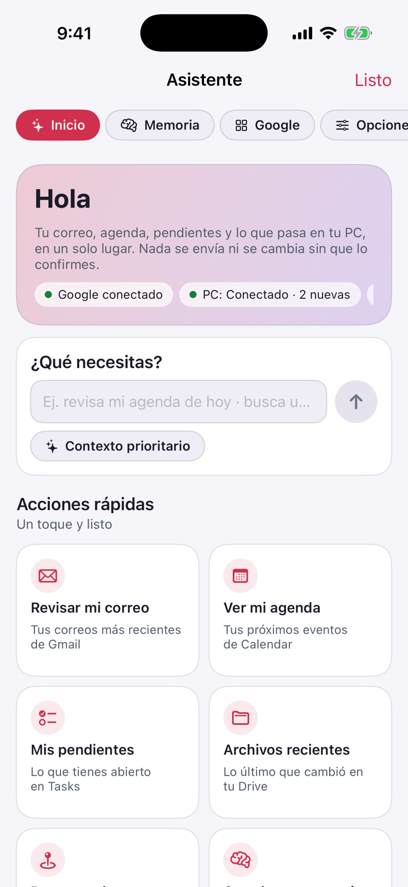
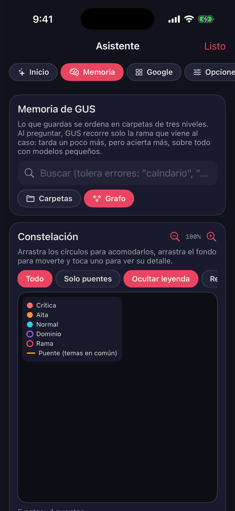

<div align="center">


# iSyCode Móvil

**Tus agentes de código, una IA local y tu Google, en el teléfono.**<br>
Nativo en Swift para iPhone y en Kotlin para Android. Funciona sin internet cuando lo necesitas.

[](https://github.com/DannyBaanks/iSyCodeMovil/actions/workflows/ios-build.yml)
[](https://github.com/DannyBaanks/iSyCodeMovil/actions/workflows/android.yml)
[](https://github.com/DannyBaanks/iSyCodeMovil/releases)
[](#instalación)
[](./LICENSE)

[Instalación](#instalación) · [GUS](#gus-ia-local) · [Asistente](#asistente-google-memoria-y-tu-pc) · [Bridge](#bridge-tu-computadora) · [Sandbox Docker](#sandbox-docker) · [Desarrollo](#desarrollo)

<br>

&nbsp;
&nbsp;
&nbsp;


<sub>Capturas del iPhone Simulator en GitHub Actions con datos de ejemplo. Se regeneran en cada build.</sub>

</div>

---

## Qué es

iSyCode Móvil es el compañero de bolsillo de **iSyCode**. Sirve para tres cosas:

1. **Seguir a tus agentes.** Dejas un agente trabajando en tu computadora (OpenCode, Codex o un sandbox Docker). Desde el teléfono ves lo que hace, apruebas sus cambios y respondes sus preguntas.
2. **Tener una IA que vive en el teléfono.** **GUS** corre modelos locales con llama.cpp. No necesita cuenta ni red, y tus mensajes no salen del dispositivo.
3. **Darle contexto real.** El **Asistente** conecta tu Google, guarda una memoria por carpetas semánticas y te avisa de lo que termina tu PC.

| | |
|---|---|
| **Conversaciones claras** | Ves por separado tus mensajes, las respuestas, las herramientas que usa el agente y sus resultados. |
| **Tú apruebas** | Cada cambio a archivos o a tus datos de Google pasa por una confirmación visible. |
| **22 modelos locales** | Qwen, Llama, Gemma, Phi, SmolLM y NVIDIA Nemotron, verificados por SHA-256 antes de usarse. |
| **Mide tu teléfono** | La app compara la memoria real disponible con lo que pide cada modelo y te dice si cabe. |
| **Google con tu cuenta** | Gmail, Calendar, Tasks, Drive, Contactos, Docs, Sheets y Classroom, con OAuth y PKCE en tu propio proyecto. |
| **Memoria semántica** | Carpetas de tres niveles, búsqueda tolerante a errores y un grafo que puedes reacomodar. |
| **Avisos de tu PC** | El daemon publica sus tareas y el teléfono te notifica; con ntfy, también con la pantalla bloqueada. |
| **Diagnóstico** | Si la app se cierra, al volver te dice en qué paso fue, con qué modelo y si fue por memoria. |
| **Claro, oscuro o automático** | Las dos apps siguen el tema del sistema o el que elijas. |

## Cómo encaja

```
      Teléfono (iOS · Android)                      Tu computadora
 ┌──────────────────────────────┐        ┌──────────────────────────────────┐
 │ GUS  ·  llama.cpp en local   │        │ iyscodemovil link                │
 │ Asistente                    │ ◄────► │   OpenCode · Codex · sandbox     │
 │   Google (OAuth del usuario) │  LAN o │ iyscodemovil notify / tasks      │
 │   memoria por carpetas       │Tailscale│   manifiesto de tareas + ntfy   │
 │   monitor de tareas de la PC │        │ daemon de iSyCode TUI / IsyMCP   │
 └──────────────────────────────┘        └──────────────────────────────────┘
```

---

## Instalación

### iPhone

1. Descarga la última versión desde [Releases](https://github.com/DannyBaanks/iSyCodeMovil/releases): `IysCodeMovil-signed.ipa` si existe; si no, `IysCodeMovil-unsigned.ipa`. Puedes verificarla con `SHA256SUMS.txt`.
2. Instálala con [iloader](https://iloader.app), [SideStore](https://sidestore.io) o [AltStore](https://altstore.io) usando tu Apple ID.
3. En **Ajustes › General › VPN y administración de dispositivos**, confía en tu Apple ID y activa el Modo de desarrollador si te lo pide.

Con un Apple ID gratuito la firma dura 7 días; después la vuelves a firmar. Antes de reinstalar, usa **Guardar copia** en la pantalla de modelos para no volver a descargar GUS.

### Android

Descarga `iSyCodeMovil-android-debug.apk` del último run del workflow [Android](https://github.com/DannyBaanks/iSyCodeMovil/actions/workflows/android.yml) e instálala. Todas las builds se firman con la misma llave, así que cada versión se instala encima de la anterior sin perder los modelos.

### Primeros pasos

| Quiero | En la app |
|---|---|
| Probar sin nada más | **Entorno de prueba › guion de demo**. Sin red ni clave. |
| Una IA sin internet | **Entorno de prueba › GUS local** y descargo un modelo. |
| Seguir a mis agentes de la PC | **Conectar** y pego el enlace del [Bridge](#bridge-tu-computadora). |
| Usar Google y la memoria | **Asistente** (iPhone: botón en Proyectos · Android: pestaña). |

---

## GUS: IA local

GUS corre dentro del teléfono con [llama.cpp](https://github.com/ggml-org/llama.cpp), fijado a un commit. Funciona en modo avión y no tiene respaldo en la nube.

**Recomendados** (hasta 1.6 GB, la mayoría de teléfonos recientes):

| Modelo | Origen | Tamaño | Para qué |
|---|---|---:|---|
| SmolLM2 135M / 360M | Hugging Face | 0.1–0.3 GB | Respuestas cortas, muy rápido |
| Qwen3 0.6B · Qwen2.5 0.5B | Alibaba | 0.4–0.5 GB | El equilibrio entre tamaño y calidad |
| TinyLlama 1.1B | TinyLlama | 0.7 GB | Ligero y probado |
| Llama 3.2 1B · Gemma 3 1B | Meta · Google | 0.8 GB | Multilingües, incluido español |
| SmolLM2 1.7B · Qwen3 1.7B · Qwen2.5 1.5B | Varios | 1.1 GB | Los más capaces de este grupo |
| Qwen1.5 1.8B | Alibaba | 1.2 GB | El modelo original de GUS (uso no comercial) |

**Experimentales**, ocultos tras un interruptor y pensados para teléfonos con más RAM: SmolLM3 3B, Llama 3.2 3B, Phi-3.5 mini y Phi-4 mini, Gemma 3 4B, Qwen3 4B, Nemotron Mini y Nano 4B, Llama 3.1 8B, Qwen3 8B y Nemotron Nano 9B v2.

**¿Cabe?** La app mide la memoria que iOS o Android le deja en ese momento:

| Etiqueta | Significado |
|---|---|
| Cabe bien | Usa menos del 70 % de lo disponible. |
| Justo | Puede funcionar; otras apps o chats largos pueden tumbarlo. Pide confirmación. |
| Probablemente no cabe | Pasa a la sección experimental. |

Lo peor que pasa con un modelo demasiado grande es que el sistema cierre la app. Al volver a abrirla, un informe te dice en qué paso fue y cuánta memoria había.

**Qué puede hacer GUS:**
- En iPhone, trabajar con los archivos del sandbox de la app (leer, buscar, editar, mover). Cada cambio pide aprobación.
- Usar las tools de Google y de memoria del Asistente.
- No tiene shell ni acceso a otras apps o al Keychain.

En Android, GUS consulta Google antes de responder, así el modelo pequeño contesta con tus datos reales.

**Benchmarks.** **Benchmark en este teléfono** mide carga, tokens por segundo, memoria y temperatura, y genera un reporte sin tus mensajes que puedes publicar. Los resultados aprobados se juntan en [docs/BENCHMARKS.md](docs/BENCHMARKS.md).

Licencias y procedencia: [aviso de modelos](docs/MODEL_NOTICE.md) · [catálogo](docs/GUS_MARKETPLACE.md).

---

## Asistente: Google, memoria y tu PC

| Sección | Qué hace |
|---|---|
| **Inicio** | Estado de Google, de la PC y de la memoria; un campo "¿Qué necesitas?" que elige la herramienta; acciones rápidas y avisos. |
| **Memoria** | Notas en carpetas de tres niveles (dominio › rama › subtema). Búsqueda tolerante a errores con historial, vista de carpetas y grafo con colores por prioridad. |
| **Google** | Gmail, Calendar, Tasks, Drive, Contactos, Docs, Sheets y Classroom. Toda escritura se confirma. |
| **Registro** | Con el modo desarrollador: cada llamada, con copiar en JSON y reintentar. |
| **Opciones** | Apariencia, notificaciones, monitor de la PC, Google y el corpus de tools. |

**Tools para los modelos.** En iPhone, el agente de GUS recibe solo las tools que vienen al caso para cada mensaje: `gmail.read.inbox`, `gmail.write.send`, `googlecalendar.*`, `googletasks.*`, `as.save.context`, `as.read.context_tree`, entre otras. Las de escritura piden aprobación cada vez. Antes de cada respuesta, el prompt recibe solo las notas de memoria que aplican.

Para usar Google necesitas un ID de cliente OAuth propio. El paso a paso está en [docs/GOOGLE_ASSISTANT.md](docs/GOOGLE_ASSISTANT.md).

---

## Bridge: tu computadora

El Bridge es un CLI de Node.js 18+ que no requiere instalación.

### Seguir a un agente

En la carpeta del proyecto:

```bash
npx --yes github:DannyBaanks/iSyCodeMovil#main link
```

Pega el enlace que imprime en **Conectar** y deja la terminal abierta. Codex es experimental y va por Tailscale ([guía remota](docs/REMOTE.md#experimental-codex-app-server)).

Fuera de casa, usa [Tailscale](https://tailscale.com) en los dos equipos. **No expongas el puerto a internet.**

### Avisos de tu PC

Tu TUI, el daemon de IsyMCP o cualquier script avisan al teléfono con un comando:

```bash
npx --yes github:DannyBaanks/iSyCodeMovil#main notify "Build de iOS listo" --body "xcodebuild OK en 4m12s" --source pc.tui
```

La tarea se guarda en `~/.iyscodemovil/tasks.json`. Para que el teléfono la lea en tu red local:

```bash
npx --yes github:DannyBaanks/iSyCodeMovil#main tasks serve
```

Pega la dirección que imprime en **Asistente › Opciones › Tu PC**. El teléfono consulta con ETag y avisa de cada tarea nueva mientras la app está abierta.

Para recibirlos también con la pantalla bloqueada, agrega `--ntfy <tema>` (o exporta `IYSCODEMOVIL_NTFY_TOPIC`) y suscríbete a ese tema en la app de [ntfy](https://ntfy.sh). El formato del manifiesto está en [docs/GOOGLE_ASSISTANT.md](docs/GOOGLE_ASSISTANT.md#2-avisos-de-tu-pc-monitor-tipo-rawgithub).

---

## Sandbox Docker

*Experimental. Viene de [MovilClaw](https://github.com/DannyBaanks/MovilClaw).*

El agente **piensa en el teléfono** (con GUS o con tu proveedor en la nube) y **trabaja en un contenedor desechable** de tu computadora. El contenedor no tiene red, no ve tu disco y no recibe tus credenciales. Al terminar, tu computadora abre el pull request.

```
Teléfono                               Tu computadora
modelo + conversación ── Tailscale ──► Bridge (token) ──► sandbox Docker
                                        └─ git push + PR con tu cuenta de GitHub
```

```bash
npx --yes github:DannyBaanks/iSyCodeMovil#main link --runtime sandbox --host tailscale
```

En la app, configura un modelo y pega el enlace `isysandbox://` en **Más opciones de conexión**.

- **Pull requests:** van siempre a una rama `movilclaw/…`, nunca a `main`, y no se fusionan solos.
- **Tu token:** el de GitHub se queda en la computadora.
- **Secretos:** archivos como `.env` no se copian al sandbox.

Detalle y garantías en [docs/SANDBOX.md](docs/SANDBOX.md).

### Sandbox del iPhone

Es un agente Swift que trabaja en el espacio privado de la app, o en una carpeta que elijas en Archivos:
- Puede clonar repositorios públicos de GitHub sin git.
- Dentro de un clon, cada cambio se puede deshacer.
- GUS local recibe siete herramientas simples y una gramática que evita llamadas mal formadas.

Más en [docs/PHONE_SANDBOX.md](docs/PHONE_SANDBOX.md).

---

## Estado

| Componente | Estado |
|---|---|
| Sandbox del iPhone | Disponible |
| OpenCode por el Bridge | Disponible |
| GUS: modelos locales, benchmark, informes de fallos | Experimental; las mediciones dependen del modelo y del teléfono |
| Asistente (Google, memoria, avisos de la PC) | Experimental; falta validarlo en teléfonos físicos |
| Codex por el Bridge | Experimental |
| Sandbox Docker con pull requests | Experimental; probado con Docker real, falta validarlo en un iPhone físico |
| Host de la TUI de iSyCode | En desarrollo: el emparejamiento ya funciona; las sesiones están en camino |

El agente no puede usar todo tu teléfono: solo ve los archivos de la app y lo que tú le des. Ver [límites de iOS](docs/IOS_LIMITATIONS.md).

## Solución de problemas

| Síntoma | Qué hacer |
|---|---|
| `Could not connect to the server` | Usa la IP de tu red o de Tailscale que imprime el Bridge, no `127.0.0.1`, y deja la terminal abierta. |
| La app dejó de abrir (iPhone) | Pasaron los 7 días de la firma: vuelve a firmarla. |
| Pide descargar los modelos otra vez | Usa **Importar desde Archivos** con tu copia; la app reconoce cada modelo por su huella. |
| Se cierra al cargar un modelo | Ese modelo no cabe ahora. Elige uno marcado "Cabe bien" y revisa **Informes de fallos**. |
| Google dice "permiso rechazado" | Habilita esa API en tu proyecto de Google Cloud y vuelve a conectar desde el Asistente. |
| No llegan avisos de la PC | Revisa que `tasks serve` siga corriendo y que el teléfono esté en la misma red. Para avisos con el teléfono bloqueado, usa `--ntfy`. |
| `Docker is not running` | Abre Docker y vuelve a ejecutar el comando. |
| El sandbox no abre el pull request | Ejecuta `gh auth login` en la computadora y comprueba que la carpeta tenga un remoto de github.com. |

---

## Desarrollo

### iOS

Necesitas macOS, Xcode, [XcodeGen](https://github.com/yonaskolb/XcodeGen) y CMake:

```bash
brew install xcodegen cmake
bash scripts/build-llama-xcframework.sh
xcodegen generate && open IysCodeMovil.xcodeproj
```

### Android

Necesitas JDK 17 y el NDK:

```bash
cd android/ISyCodeMovil && ./gradlew :app:testDebugUnitTest :app:assembleDebug
```

### Pruebas y CI

| Qué | Cómo |
|---|---|
| Pruebas del Bridge (no necesitan Docker) | `npm run test:bridge` |
| CI de iOS | Compila, corre las pruebas en el simulador, toma las capturas de este README y publica una pre-release con su SHA-256. |
| CI de Android | Corre las pruebas JVM y compila el APK con llama.cpp por NDK. |
| Catálogo de GUS | `Catalog/models.json` es la fuente de verdad; cada GGUF se prueba con el bridge real ([docs/GUS_MARKETPLACE.md](docs/GUS_MARKETPLACE.md)). |

Documentación: [uso](docs/USAGE.md) · [conexión](docs/REMOTE.md) · [Asistente](docs/GOOGLE_ASSISTANT.md) · [sandbox Docker](docs/SANDBOX.md) · [sandbox del iPhone](docs/PHONE_SANDBOX.md) · [compatibilidad con OpenCode](docs/OPENCODE_COMPAT.md) · [roadmap](docs/ROADMAP_CLIS.md)

## Licencia

El código es [MIT](LICENSE). Cada modelo de GUS conserva su propia licencia, que la app muestra antes de descargarlo.

iSyCode Móvil no está afiliado con OpenCode, OpenAI, Anthropic, Google, Meta, Microsoft, Alibaba, NVIDIA, Hugging Face, xAI ni OpenRouter.
