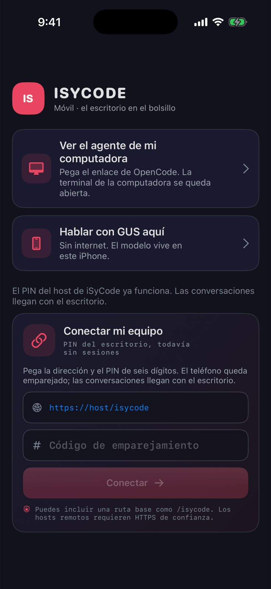
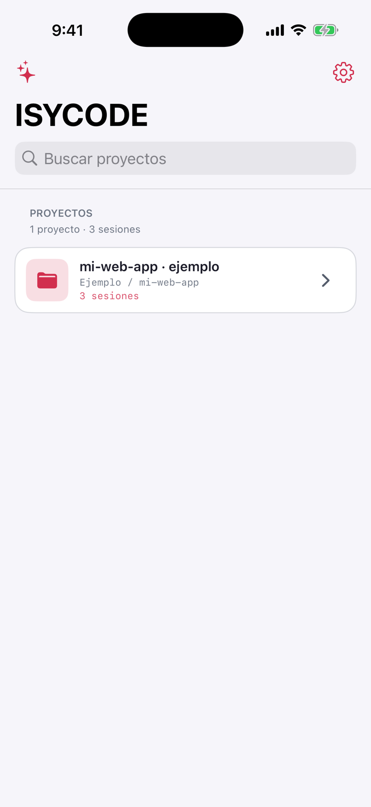
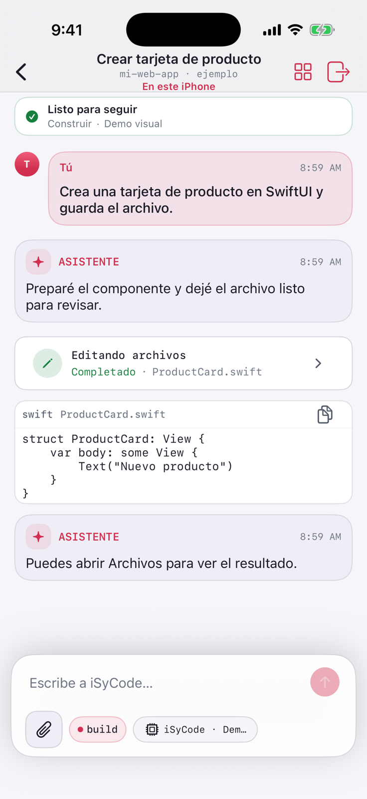

<div align="center">


# iSyCode Móvil

### Tus agentes y tu propia IA, contigo en el iPhone. Incluso sin internet.

[](https://github.com/DannyBaanks/iSyCodeMovil/actions/workflows/ios-build.yml)
[](https://github.com/DannyBaanks/iSyCodeMovil/releases)
[](#-instálala)
[](#-gus-una-ia-que-vive-en-tu-iphone)
[](./LICENSE)

[Instalar](#-instálala) · [GUS sin internet](#-gus-una-ia-que-vive-en-tu-iphone) · [Conectar tu compu](#-conecta-tu-computadora) · [Sandbox Docker](#-sandbox-docker-en-tu-computadora) · [Si algo no jala](#-si-algo-no-jala)

</div>

---

## ¿Qué es esto?

Dejaste a un agente trabajando en tu computadora y saliste de casa. Abres **iSyCode Móvil**, ves qué hizo, le das permiso para seguir y listo, sin volver al escritorio.

¿Estás en el metro, sin señal? Abres **GUS**, una IA que vive **dentro de tu iPhone**. Nada sale del teléfono y no necesitas cuenta ni internet.

| | |
|---|---|
| 💬 **Tus conversaciones, claras** | Ves por separado tus mensajes, lo que responde el agente, las herramientas que usa y sus resultados. |
| ✋ **Tú decides** | Cuando el agente quiere cambiar algo, te pregunta. Apruebas o rechazas desde el celular. |
| 🧠 **GUS: IA sin internet** | Elige entre **22 modelos** (Qwen, Llama, Gemma, Phi, SmolLM, NVIDIA Nemotron…) y úsalos offline. |
| 📏 **Sabe qué cabe en tu iPhone** | La app mide la memoria real de tu teléfono y te dice qué modelo va bien, cuál va justo y cuál no. |
| 📊 **Benchmarks de la comunidad** | Mide qué tan rápido corre cada modelo en tu iPhone y publica el resultado para ayudar a otros. |
| 🩺 **Si se cierra, te dice por qué** | Al volver a abrirla sabes en qué estaba, con qué modelo y si fue por falta de memoria. |
| 💾 **No vuelvas a descargar** | Guarda tus modelos en Archivos y recupéralos al reinstalar la app. |
| 🧪 **Sandbox en el bolsillo** | Un agente que trabaja con los archivos privados de la app o con la carpeta que tú elijas. |
| 📦 **Sandbox Docker en tu compu** | El agente piensa en el iPhone y trabaja en un contenedor aislado de tu computadora. Al terminar, tu computadora abre el pull request. |
| 🎨 **Tu estilo** | Temas Consola y Premium. |

> iSyCode Móvil es el compañero de bolsillo de **iSyCode**, la experiencia de escritorio que estamos por publicar.

---

## 📸 La app por dentro

| Conectar | Proyectos | Conversación |
| :---: | :---: | :---: |
|  |  |  |
| **Empareja o prueba sin conexión.** | **Encuentra tu espacio.** | **Sigue cada acción del agente.** |

<p align="center"><sub>Capturas generadas en el iPhone Simulator de GitHub Actions con datos de ejemplo. Ninguna viene de un teléfono personal.</sub></p>

---

## 🚀 Empieza en 3 pasos

**1. Instala la app.** Baja la IPA y fírmala con tu Apple ID ([cómo, aquí abajo](#-instálala)).

**2. Elige cómo empezar:**

| Quiero… | Toco… |
|---|---|
| Probar la app sin nada más | **Entorno de prueba → guion de demo**. Es offline y no pide clave. |
| Una IA que funcione sin internet | **Entorno de prueba → GUS local**, y descargo un modelo. |
| Ver a mis agentes de la compu | **Conectar**, y pego el enlace del Bridge ([ver cómo](#-conecta-tu-computadora)). |
| Que el agente trabaje en un repo y abra el PR | Configuro un modelo en **Entorno de prueba** y pego el enlace `isysandbox://` ([ver cómo](#-sandbox-docker-en-tu-computadora)). |

**3. Conversa.** Abre una sesión, mira lo que hace el agente y responde cuando te pida permiso.

### 📲 Instálala

1. Entra a [**Releases**](https://github.com/DannyBaanks/iSyCodeMovil/releases) y baja la última versión. Usa `IysCodeMovil-signed.ipa` si aparece; si no, `IysCodeMovil-unsigned.ipa`.
2. Si quieres comprobar el archivo, usa `SHA256SUMS.txt`.
3. Instálala con [**iloader**](https://iloader.app), [SideStore](https://sidestore.io) o [AltStore](https://altstore.io) usando tu Apple ID.
4. En el iPhone ve a **Ajustes → General → VPN y administración de dispositivos**, confía en tu Apple ID y activa el **Modo de desarrollador** si te lo pide.

> ⏳ Con un Apple ID gratuito la app **dura 7 días**. Después vuelves a firmarla y sigue funcionando.
>
> 💾 Antes de reinstalar, usa **Guardar copia** en la pantalla de modelos para no volver a descargar GUS ([ver abajo](#-no-vuelvas-a-descargar-tus-modelos)).

---

## 🧠 GUS: una IA que vive en tu iPhone

GUS corre **dentro del teléfono** con [llama.cpp](https://github.com/ggml-org/llama.cpp). Tus mensajes no salen del iPhone, no hay cuenta ni clave, y funciona en modo avión.

**Cómo:** **Entorno de prueba → Proveedores → GUS local**. Elige un modelo, descárgalo una vez y listo.

### Los modelos

**Recomendados:** pesan hasta 1.6 GB y funcionan en la mayoría de iPhones recientes.

| Modelo | De | Tamaño | Lo bueno |
|---|---|---:|---|
| SmolLM2 135M | Hugging Face | 0.1 GB | Diminuto y rapidísimo |
| SmolLM2 360M | Hugging Face | 0.3 GB | Ligero para respuestas cortas |
| Qwen3 0.6B | Alibaba | 0.4 GB | Razona antes de contestar |
| Qwen2.5 0.5B | Alibaba | 0.5 GB | El equilibrio clásico |
| TinyLlama 1.1B | TinyLlama | 0.7 GB | Clásico y ligero |
| Llama 3.2 1B | Meta | 0.8 GB | Multilingüe, incluye español |
| Gemma 3 1B | Google | 0.8 GB | Multilingüe, de Google |
| SmolLM2 1.7B | Hugging Face | 1.1 GB | El más capaz de los Smol |
| Qwen3 1.7B | Alibaba | 1.1 GB | Razonamiento en poco espacio |
| Qwen2.5 1.5B | Alibaba | 1.1 GB | Sólido para todo |
| Qwen1.5 1.8B | Alibaba | 1.2 GB | El original de GUS (uso no comercial) |

**Experimentales 🧪:** para iPhones con más RAM, como un Pro reciente. Están ocultos tras un interruptor.

| Modelo | De | Tamaño |
|---|---|---:|
| SmolLM3 3B | Hugging Face | 1.9 GB |
| Llama 3.2 3B | Meta | 2.0 GB |
| Phi-3.5 mini · Phi-4 mini | Microsoft | 2.4–2.5 GB |
| Gemma 3 4B | Google | 2.5 GB |
| Qwen3 4B | Alibaba | 2.5 GB |
| Nemotron Mini 4B · Nemotron Nano 4B | NVIDIA | 2.7–2.8 GB |
| Llama 3.1 8B | Meta | 4.9 GB |
| Qwen3 8B | Alibaba | 5.0 GB |
| **Nemotron Nano 9B v2** | NVIDIA | 6.5 GB |

Cada modelo lleva su licencia, su origen y su huella SHA-256. La app **verifica cada archivo antes de usarlo**; si no coincide, lo borra. Los modelos nunca vienen dentro de la app: los descargas tú, y la descarga sigue aunque bloquees la pantalla.

### 📏 ¿Cabe en mi iPhone?

No adivinamos por el nombre del modelo de iPhone. La app mide **cuánta memoria le deja iOS en ese momento** y la compara con lo que necesita cada modelo:

| Etiqueta | Qué significa |
|---|---|
| 🟢 **Cabe bien** | Usa menos del 70 % de lo disponible. |
| 🟡 **Justo** | Puede funcionar, pero otras apps abiertas o chats largos lo pueden tumbar. Te pide confirmar. |
| 🔴 **Probablemente no cabe** | Pasa a la sección experimental. |

> **¿Y si me arriesgo con uno grande?** Lo peor que pasa es que **iOS cierra la app**, el teléfono se calienta un rato o se llena el almacenamiento. Tus datos y tu iPhone están a salvo. Si la app se cierra, al volver te dice exactamente por qué.

### 💾 No vuelvas a descargar tus modelos

iOS borra los datos de una app cuando la eliminas o cuando la reinstalas con otro identificador, algo común al firmar con iloader o SideStore. Para no perder tus modelos:

1. En la pantalla de GUS toca **Guardar copia** y elige una carpeta **fuera** de iSyCode, por ejemplo *En mi iPhone › Descargas* o iCloud Drive.
2. Después de reinstalar, toca **Importar desde Archivos** y elige esa carpeta.

La app reconoce cada modelo por su huella, **aunque le hayas cambiado el nombre**, y lo deja listo sin descargar nada.

### 🔒 Lo que GUS puede y no puede hacer en iPhone

- **Puede trabajar con archivos del sandbox** usando una superficie de miniagente: leer, buscar, editar texto, reemplazar rangos de líneas, append, copiar, mover/renombrar y borrar dentro del workspace autorizado.
- **Cada cambio pide aprobación visible de nuevo.** Un permiso anterior no autoriza automáticamente la siguiente mutación.
- **No tiene shell ni puede lanzar procesos**, y tampoco obtiene acceso general al iPhone, otras apps o secretos del Keychain.
- **No manda la inferencia de GUS a la nube** ni tiene fallback remoto.

Detalles, licencias y procedencia: [aviso de modelos](docs/MODEL_NOTICE.md) · [cómo funciona el catálogo](docs/GUS_MARKETPLACE.md).

---

## 📊 Benchmarks: ¿qué tan rápido va en tu iPhone?

Todos los modelos ya pasaron una prueba en computadora. Lo que falta son **mediciones en iPhones reales**, y ahí entras tú.

1. Descarga un modelo y toca **Benchmark en este iPhone**.
2. La app corre 4 tareas fijas y mide carga, velocidad (tokens por segundo), memoria máxima y temperatura.
3. Toca **Publicar en GitHub**, pega el JSON en el formulario y envíalo.

El reporte **no incluye tus mensajes**, solo números. Cuando se aprueba, aparece en la tabla de [**Benchmarks**](docs/BENCHMARKS.md), agrupado por modelo y por iPhone.

> Si iOS cierra la app a media prueba, también sirve: se publica como **KILLED** y le dice a todos dónde deja de caber ese modelo.

---

## 🩺 Si la app se cierra, sabrás por qué

Como esas apps que te muestran un informe cuando algo falla. Antes de cada paso delicado (cargar un modelo, generar una respuesta) la app anota en qué va y cuánta memoria usa. Si iOS la cierra, al volver a abrirla te dice algo como:

> ⚠️ **La app terminó durante la carga del modelo · Qwen3 4B.**
> Probablemente iOS la cerró por exceder su límite de memoria. Última medición: 2.9 GB en uso, 40 MB disponibles.

- **Historial completo** en **Informes de fallos**.
- **Confirmación de Apple** cuando llega (MetricKit), con la pila técnica para depurar.
- **Exporta o reporta** con un toque, usando el [formulario de fallos](https://github.com/DannyBaanks/iSyCodeMovil/issues/new?template=crash-report.yml).
- **Nunca guarda** el texto de tus mensajes ni de las respuestas.

---

## ✨ Asistente: Google, memoria y avisos de tu PC

En iPhone toca **Asistente** en Proyectos; en Android abre la pestaña **Asistente**.

- **Google con tu propia cuenta:** Gmail, Calendar, Tasks, Drive, Contactos, Docs, Sheets y Classroom. Nada se envía ni se cambia sin que lo confirmes.
- **Memoria por carpetas semánticas** (dominio › rama › subtema), con búsqueda tolerante a errores, historial y un grafo que puedes acomodar. GUS usa solo las notas que vienen al caso.
- **Avisos de tu PC:** el daemon de iSyCode / IsyMCP publica un JSON (por ejemplo en `raw.githubusercontent.com`) y el teléfono te avisa de cada tarea nueva.
- **Tools para cualquier modelo** (`gmail.read.inbox`, `as.save.context`…), y las de escritura piden tu aprobación cada vez.
- **Modo oscuro automático** en las dos apps; también puedes fijar claro u oscuro.

Configuración paso a paso: [docs/GOOGLE_ASSISTANT.md](docs/GOOGLE_ASSISTANT.md).

## 💻 Conecta tu computadora

### OpenCode (disponible hoy)

En tu computadora (Node.js 18+ y OpenCode instalados), entra a la carpeta del proyecto y ejecuta:

```bash
npx --yes github:DannyBaanks/iSyCodeMovil#main link
```

Copia el enlace que aparece, abre **Conectar con Bridge anterior** en la app y pégalo. Deja la terminal abierta mientras lo uses.

### Codex (experimental)

Chat, streaming y aprobaciones por Tailscale. Ver la [guía remota](docs/REMOTE.md#experimental-codex-app-server).

### Sandbox Docker (experimental)

El agente del iPhone trabaja en un contenedor de tu computadora y abre pull requests. Tiene [su propia sección](#-sandbox-docker-en-tu-computadora).

### Host de iSyCode (en camino)

El emparejamiento con PIN de 6 dígitos ya funciona. Las sesiones llegan con la versión de escritorio.

> 🌎 **¿Fuera de casa?** Instala [Tailscale](https://tailscale.com) en la computadora y en el iPhone, y usa su dirección. **No expongas el puerto 4096 a Internet**: el Bridge es para tu red de confianza o una VPN.

---

## 📦 Sandbox Docker en tu computadora

> 🧪 **Experimental.** Viene de [MovilClaw](https://github.com/DannyBaanks/MovilClaw), ahora dentro del Bridge.

Aquí el agente no vive en tu computadora: **piensa en el iPhone** (con GUS o con tu proveedor en la nube) y **trabaja en un contenedor Docker** de tu compu. El contenedor es desechable y está aislado:

```
iPhone                                Tu computadora
──────                                ──────────────
modelo + conversación  ── Tailscale ─►  Bridge (token) ─► sandbox Docker
                                        │                 sin red · sin tu disco · sin credenciales
                                        └─ git push + PR con tu cuenta de GitHub
```

**Necesitas** Docker, Node.js 18+ y [Tailscale](https://tailscale.com) en la computadora y en el iPhone.

**1.** En la carpeta del proyecto:

```bash
npx --yes github:DannyBaanks/iSyCodeMovil#main link --runtime sandbox --host tailscale
```

La primera vez construye la imagen del sandbox. Deja la terminal abierta.

**2.** En el iPhone configura un modelo en **Entorno de prueba** (proveedor y clave, o GUS local).

**3.** Abre **Más opciones de conexión**, pega la línea `isysandbox://pair?...` y conecta. La app copia tu carpeta al sandbox y abre la sesión.

Qué puedes hacer desde ahí:

| | |
|---|---|
| 🛠️ **Trabajar sin interrupciones** | Leer, buscar, editar, ejecutar comandos y hacer commits no piden permiso: nada sale del contenedor. |
| 🔀 **Abrir el pull request** | Lo pide el agente (y tú lo apruebas) o lo abres tú desde el panel **Sandbox**. Va a una rama `movilclaw/…`; nunca a `main` y nunca se fusiona solo. |
| 📤 **Compartir** | La conversación como texto, o el trabajo del sandbox como `.tar.gz`. |
| ♻️ **Retomar o empezar de cero** | Si vuelves a conectar, la app retoma el sandbox que sigue vivo. Caduca tras 2 h sin uso. |

Lo que conviene saber:

- **Tu cuenta de GitHub no sale de la computadora.** El Bridge usa el token de `gh auth token` (o `GITHUB_TOKEN`); no entra al sandbox ni llega al iPhone. Sin token solo no hay pull requests.
- **Tus secretos se quedan fuera.** Los `.env`, claves y similares no se copian al sandbox.
- **No reenvíes el enlace.** Lleva el token que da acceso a los sandboxes de esa terminal. `Ctrl+C` lo invalida y destruye los sandboxes.
- **El sandbox no tiene internet**, así que no puede instalar dependencias desde dentro.
- **Lo que el agente lee viaja a tu proveedor de modelo**, igual que en cualquier otra sesión. Con GUS no sale nada, pero los modelos locales pequeños rara vez manejan bien un repositorio.

Todo el detalle, con las garantías y los límites, en la [guía del sandbox](docs/SANDBOX.md).

---

## 🧪 El sandbox del iPhone

Un agente Swift que trabaja dentro del espacio privado de la app:

- Prueba el **demo sin internet** o conecta un proveedor en la nube: NVIDIA NIM, xAI, OpenAI API, Gemini u OpenRouter.
- **Dale una carpeta** desde Archivos si quieres; puedes quitarle el permiso cuando sea.
- **Aprueba cada cambio** de archivos antes de que ocurra.
- **Clona un repositorio público de GitHub** sin git: en **Ajustes → Repositorios en este iPhone**, o pidiéndoselo al agente. Es una copia desechable en `repos/`.
- **Dentro de un clon, GUS trabaja sin interrumpirte**: los cambios se aplican sin pedir aprobación y cada uno se puede **deshacer**.

Para que un modelo pequeño pueda usarlo de verdad, GUS local recibe solo siete herramientas sencillas (`clone`, `list`, `read`, `find`, `edit`, `write`, `undo`) y una **gramática** que le impide escribir una llamada a herramienta mal formada. Detalle en la [guía del sandbox del iPhone](docs/PHONE_SANDBOX.md).

Tus claves se guardan en el **Keychain** del iPhone. Si eliges un modelo en la nube, lo que le mandes sale hacia ese proveedor. Si eliges **GUS**, no sale nada.

---

## ✅ Qué puedes hacer hoy

| Experiencia | Estado |
|---|---|
| Sandbox en el iPhone | ✅ Disponible |
| GUS: 22 modelos locales, miniagente de archivos, benchmark e informes de fallos | 🧪 Experimental: runtime y CI en validación; mediciones físicas dependen del modelo/iPhone |
| OpenCode en tu computadora | ✅ Disponible con el Bridge |
| Codex en tu computadora | 🧪 Experimental |
| Sandbox Docker en tu computadora, con pull requests | 🧪 Experimental: el Bridge está probado con Docker real; falta validarlo en un iPhone físico |
| Host de la TUI de iSyCode | 🚧 En desarrollo: emparejamiento listo, sesiones en camino |

### ¿El agente puede usar todo mi iPhone?

No. Empieza en los archivos privados de la app y solo ve una carpeta externa si tú la eliges. No puede leer datos de otras apps ni controlar tu pantalla. Ver [límites de iOS](docs/IOS_LIMITATIONS.md).

---

## 🆘 Si algo no jala

| Pasa esto | Prueba esto |
|---|---|
| `Could not connect to the server` | No uses `127.0.0.1`: usa la IP de tu red o de Tailscale que muestra el Bridge, y revisa que siga abierto. |
| El enlace no abre la app | Copia el enlace completo `iyscodemovil://…` y pégalo en la pantalla de conexión. |
| La app no instala o dejó de abrir | Fírmala otra vez (pasaron los 7 días) y confía en tu Apple ID en Ajustes. |
| Me pide descargar los modelos otra vez | iOS borró los datos al reinstalar. Usa **Importar desde Archivos** con tu copia. Si no tenías copia, descárgalos y toca **Guardar copia**. |
| La app se cierra al cargar un modelo | Ese modelo no cabe ahora. Cierra otras apps o elige uno marcado 🟢. El detalle está en **Informes de fallos**. |
| GUS tarda mucho en responder | Los modelos grandes van más lentos y el iPhone se calienta. Prueba uno más chico. |
| `Rate limited` | El proveedor en la nube limitó tus llamadas. Espera un poco y revisa tu cuota. |
| El sandbox no ve mi carpeta | Vuelve a elegirla desde Archivos dentro de la app. |
| `Docker is not running` al enlazar el sandbox | Abre Docker en la computadora y vuelve a ejecutar el comando. |
| El comando del sandbox pide `--host tailscale` | El sandbox solo escucha por Tailscale. Instálalo en la computadora y en el iPhone, y añade `--host tailscale`. |
| La app rechaza el enlace `isysandbox://` | El enlace caduca al cerrar la terminal. Ejecuta el comando otra vez y pega el nuevo. |
| El agente no puede abrir el pull request | Inicia sesión en la computadora con `gh auth login`, comprueba que la carpeta tenga un remoto de github.com y vuelve a enlazar. |

---

<details>
<summary><b>🛠️ Para desarrolladores: compilar y contribuir</b></summary>

<br>

Necesitas macOS, Xcode, [XcodeGen](https://github.com/yonaskolb/XcodeGen) y CMake:

```bash
brew install xcodegen cmake
bash scripts/build-llama-xcframework.sh   # llama.cpp fijado a un commit
xcodegen generate
open IysCodeMovil.xcodeproj
```

- **CI:** cada push a `main` compila la app, corre las pruebas en el iOS Simulator, genera las capturas de este README y publica una pre-release con la IPA y sus SHA-256.
- **Catálogo de GUS:** `Catalog/models.json` es la fuente de verdad. El workflow *GUS model catalog* resuelve cada modelo en Hugging Face, compila el bridge real de la app en Linux y lo prueba con cada GGUF. Para agregar un modelo, sigue [docs/GUS_MARKETPLACE.md](docs/GUS_MARKETPLACE.md).
- **Bridge:** `npm run test:bridge` corre las pruebas del Bridge y de la pasarela del sandbox; no necesita Docker. El orquestador en `Bridge/sandbox/` es una copia de MovilClaw; sus cambios locales están anotados en [Bridge/sandbox/README.md](Bridge/sandbox/README.md).
- **Benchmarks:** los reportes se validan con `scripts/benchmarks/validate.py` y se agregan a [docs/BENCHMARKS.md](docs/BENCHMARKS.md).

Más documentación:
- [Uso detallado](docs/USAGE.md)
- [Conexión y transporte](docs/REMOTE.md)
- [Sandbox Docker en la computadora](docs/SANDBOX.md)
- [Sandbox del iPhone: clonar, herramientas simples y gramática](docs/PHONE_SANDBOX.md)
- [Compatibilidad con OpenCode](docs/OPENCODE_COMPAT.md)
- [Roadmap de runtimes](docs/ROADMAP_CLIS.md)
- [Propuesta MCP](docs/CHATGPT_MCP.md)

</details>

## Licencia

El código es **MIT**; ver [LICENSE](LICENSE). Cada modelo de GUS conserva su propia licencia, que ves en la app antes de descargarlo.

iSyCode Móvil no está afiliado con OpenCode, OpenAI, Anthropic, Google, Meta, Microsoft, Alibaba, NVIDIA, Hugging Face, xAI ni OpenRouter.